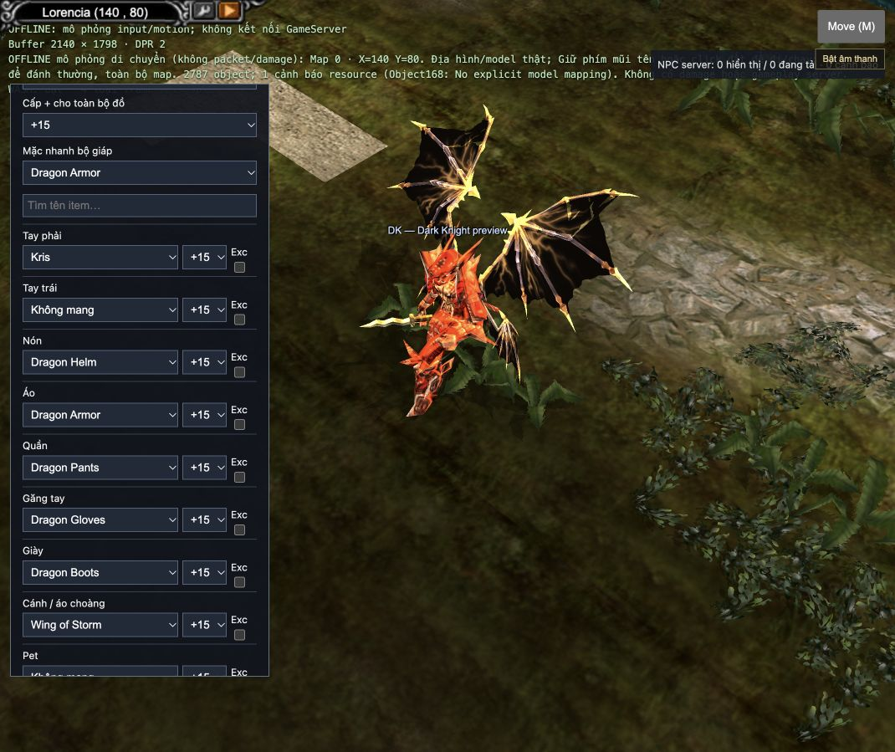

# W0113 — Preview trang bị tùy chọn

Ngày: 2026-10-31.

## Mở công cụ
`http://127.0.0.1:8080/?scene=terrain-check&map=0&x=140&y=80&equippreview=1&class=1&tier=2`

- Chọn một trong7 class và bậc chuyển chức. Đổi class/bậc nạp lại preview và tháo đồ thử để tránh cấu hình sai.
- Mặc nhanh bộ giáp cùng type hoặc chọn riêng12 ô. RF không có găng, MG không có nón nếu bảng class không cho phép. Chỉ liệt kê item có tên/kích thước và mapping model.
- Chọn +0..+15 từng món hoặc cho toàn bộ ô; Excellent bật riêng từng món. Đổi trực tiếp qua live-view.equipment và atomic actor swap của game; dùng bindUpgradeMeshes/material/palette thực tế đang dùng trên nhân vật.
- Tìm tên item, tháo toàn bộ, phóng to1..3×, đổi8 hướng. Có thể click đất/phím mũi tên để đi/chạy theo terrain. Đổi hướng đặt lại tọa độ fixture; mức zoom và đồ được giữ bằng URL, không tạo cache ổ đĩa.
- Cấu hình đồ lưu trong query equipment dạng slot.index.level.excellent, được kiểm tra lại khi refresh. Sai class, trùng ô, level>15, pairing hai tay/khiên không hợp lệ đều bị chặn. Thông báo đỏ nghĩa cấu hình mới chưa áp dụng, model trước được giữ.

## An toàn dữ liệu và giới hạn
Không đăng nhập/không gửi giao dịch GameServer. Data model/texture được tải qua Identity asset đọc-only như cảnh offline hiện có. Mức nhân vật thử1000, chỉ số validation65535, chỉ dùng kiểm tra hình ảnh: không kiểm điều kiện stat/level thực của nhân vật hay mô phỏng damage. Nhẫn/dây chuyền không có hình ngoài map theo pipeline game. Preview tái sử dụng các effect đã triển khai; không phải chứng nhận mọi effect custom chưa port.

Zoom dùng chung projection renderer/picking để thao tác click không lệch; chỉ bật trong cảnh equippreview, dispose trả1×. World game bình thường giữ mặc định1×.

## Kiểm tra
102 test mục tiêu qua, gồm đọc bảng Item_eng.bmd thật cho7class/12slot, RF không găng, lọc bậc cánh, URL roundtrip +15/Excellent, từ chối config sai và xung đột vũ khí hai tay/khiên, projection zoom reset.

Trình duyệt: chọn DK→Dragon Armor→+9 (5 món), thêm Kris và Wing of Storm (7 món), refresh khôi phục, đổi RF xác nhận chỉ có Không mang ở ô găng, trả DK và đổi +15 trực tiếp. Lưu ảnh sau khi zoom1× để thấy toàn bộ cánh. Không thay dữ liệu nhân vật thật.

