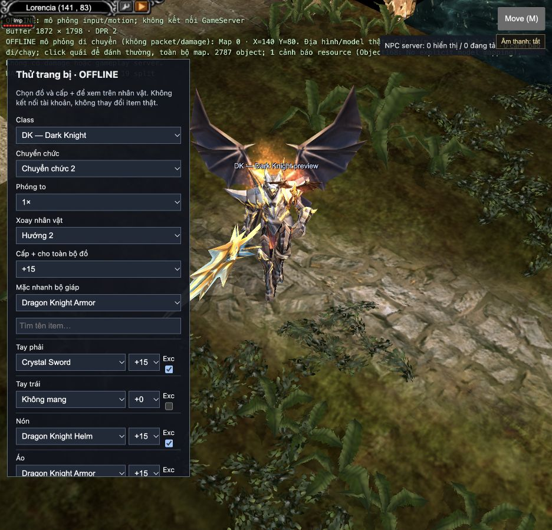

# W0114 — Khói bộ trang bị +10…+15 (2026-10-31)

Đã bổ sung lớp hạt cho preview trang bị và nhân vật trong game, kể cả người chơi khác. Không sửa Data hay tài khoản. Đây là port phần khói màu; không khẳng định đã hoàn thành toàn bộ tia/joint/ánh mắt của bộ +15.

## Đối chiếu source gốc

- `Main5.2/source/ZzzCharacter.cpp`, `CheckFullSet` khoảng 5446: cùng loại cả bộ, lấy cấp thấp nhất; MG không yêu cầu nón, RF không yêu cầu găng.
- Cùng file khoảng 10676–10788: bộ type 29–33 và 43, từ +10; +10/+11/+12 phát với xác suất 1/4, 1/3, 1/2; +13…+15 phát mỗi tick. Ba điểm gắn bone 0: (0,±18,50)/(0,0,70), từ +13 đổi ±20. Không phát tại Chaos Castle 18–23,53.
- Màu RGB: 29=(.65,.3,.1),30=(.1,.1,.9),31=(0,.32,.24),32=(.5,.24,.8),33=(.6,.4,0),43=(.6,.3,.4).
- `ZzzEffectParticle.cpp` khoảng 3588 và 8486: WATERFALL_2 subtype 3 thực tế dùng LIGHT+2; lifetime 12 tick, scale .54/.72/.90, vận tốc Z ban đầu 2, scale mỗi tick giảm .008, vận tốc Z tăng .08, giảm sáng theo tuổi.
- `ZzzOpenData.cpp` khoảng 5734: LIGHT+2 là `Effect/cra_04.jpg`; nạp trực tiếp `Data/Effect/cra_04.OZJ`, linear/clamp, cộng màu. Simulation 25 Hz, tối đa 512 hạt.

Dragon type1 và Dark Phoenix type17 không có khói màu trong nhánh source này dù +15. Dragon Knight type29 có khói cam vàng; Sunlight type33 có khói vàng. Chưa tìm thấy bảng CustomSmokeItem bổ sung nên không gán màu tưởng tượng cho các bộ khác.

## Kiểm tra

107 test chọn lọc (gồm 5 test mới): điều kiện đủ bộ, cấp thấp nhất, màu, MG/RF, vòng đời, transform bone và khởi tạo/render/dispose lớp hạt rỗng. Dựng WASM mới và debug/release trong thư mục cô lập, không làm mất dist đang chạy.

Trình duyệt: Dragon Knight +15 có 36 hạt ở trạng thái ổn định; hạ cả bộ +9 còn 0. Dragon +15 không phát. Việc đồng bộ người chơi khác đã nối cùng pipeline nhưng chưa xác nhận bằng hai phiên server thật trong lượt này.

