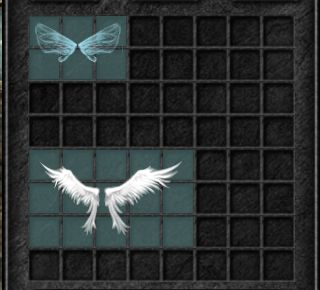
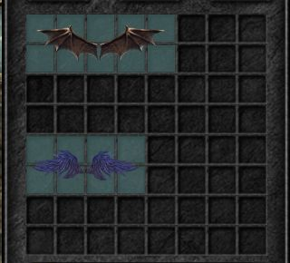
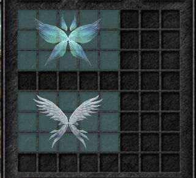
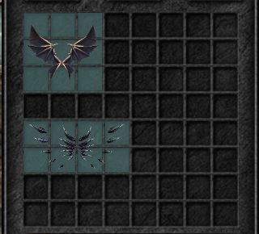
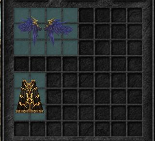
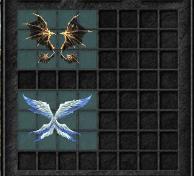
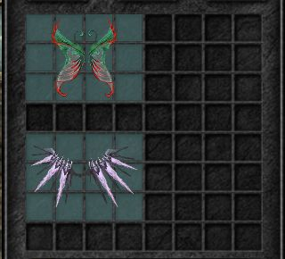
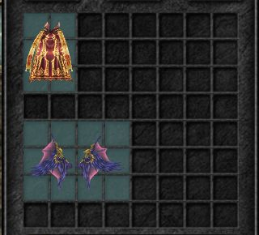
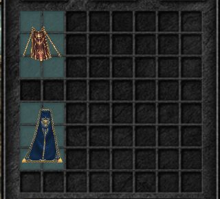

# W0112 — Kiểm tra toàn bộ icon cánh cấp 1–3

Ngày: 2026-10-31.

## Nguyên nhân đã xác định và sửa
1. Cùng resource BMD/OZT nhưng icon thiếu phép đổi chiều V có sẵn trong `attachment_geometry.hpp` cho texture cánh TGA. Alpha/chi tiết lông bị lấy sai hàng nên hình dáng sai, đuôi mất và trông như ngược. Đã dùng cùng chiều UV cho icon; không thay resource.
2. Đã bỏ toàn bộ thử nghiệm xoay riêng Wings of Heaven, khôi phục [270,-10,0], gồm Y=-10 theo yêu cầu. Source ScriptItem fallback và AngleMatrix giữ nguyên. Các nhận định W0105/W0108 chỉ do góc nhìn đã được thay thế bởi nguyên nhân UV này.
3. Phát hiện cánh Elf cấp1 có tam giác nền đen khi vẽ additive lên canvas trong suốt. Đã thêm alpha matte theo độ sáng trong fragment shader khi `inventory && additive`; nhánh world giữ nguyên. Elf/Spirits kiểm tra lại hết nền đen. Đây là chuyển đổi vật liệu cho canvas RGBA, không khẳng định cộng sáng pixel-for-pixel với framebuffer native.

## Phạm vi kiểm tra
- 18 wing/cape từ cấp1–3: Elf, Heaven, Satan, Curse, Spirits, Soul, Dragon, Darkness, Despair, Fighter, Storm, Eternal, Illusion, Ruin, Emperor, Dimension, Overrule, Lord.
- 18 model/30 mesh: đọc BMD và texture Data thật, checksum SHA256 ghi trong `WING-ICONS-W0111.json`; không thiếu file hoặc lỗi decode. UV so với đường gắn cánh trên nhân vật khớp ở mesh dùng cùng hình học; áo choàng cloth có hình học riêng được ghi rõ.
- Trình duyệt mở đủ9 nhóm, không iconMissing. Lưu ảnh từng nhóm bên dưới. Storm được kiểm tra lại khi data-rotating=false: đủ hai cánh, không phải icon bị nghiêng cố định. Kiểm tra nguồn góc/source Data không đồng nghĩa chứng nhận tất cả chi tiết bằng native từng pixel.
- 98 test mục tiêu qua; build debug142/release38. Không thay đồ/tài khoản thật. Đây là rà icon inventory; animation cánh trên người và điều kiện class có kiểm kê riêng ở W0095/W0097.
- Violent Wind Helm giữ tỷ lệ trước thử nghiệm W0107; không áp dụng fallback làm nón quá nhỏ. Tỷ lệ native riêng của nón chưa được chốt trong công việc cánh lần này.

## Ảnh kiểm tra

### Nhóm 1 — Wings of Elf / Wings of Heaven

### Nhóm 2 — Wings of Satan / Wing of Curse

### Nhóm 3 — Wings of Spirits / Wings of Soul

### Nhóm 4 — Wings of Dragon / Wings of Darkness

### Nhóm 5 — Wind of Despair / Cape of Fighter

### Nhóm 6 — Wing of Storm / Wing of Eternal

### Nhóm 7 — Wing of Illusion / Wing of Ruin

### Nhóm 8 — Cape of Emperor / Wing of Dimension

### Nhóm 9 — Cape of Overrule / Cape of Lord

